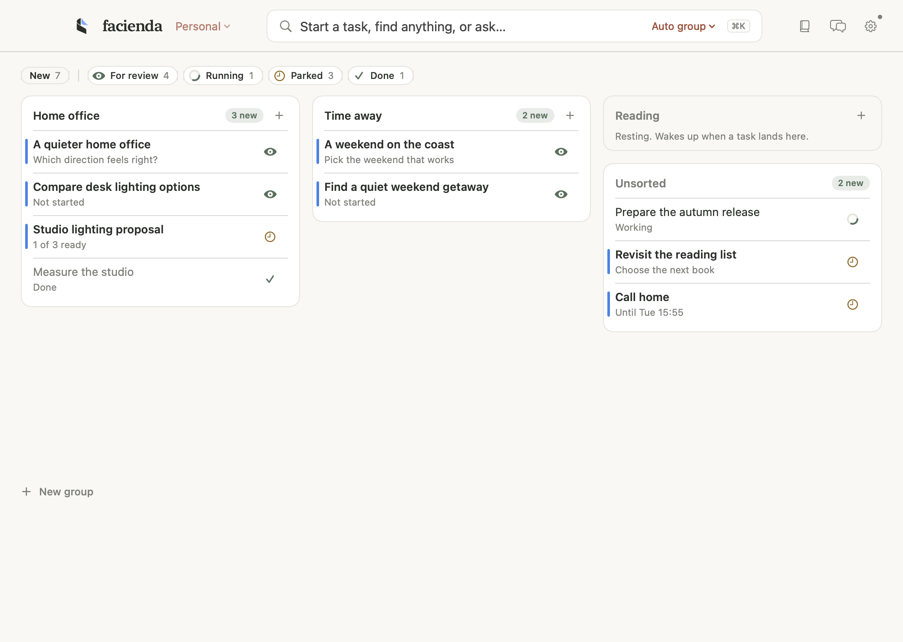

# Facienda

**Things that must be done. A little less on your mind.**

A native macOS dashboard for the tasks you hand to Codex and Claude. Each task keeps its goal, next step and decisions; agents do the work and report back, and you decide when it is done.



## Install

Download the latest **[Facienda.dmg](https://github.com/jostelzer/facienda/releases/latest)**, open it and move Facienda to Applications. It updates itself.

Needs macOS 26 or later and the ChatGPT/Codex app, signed in. Claude is optional.

Facienda adds a permission hook to `~/.claude/settings.json` (keeping a backup), registers a background helper for Codex, and creates a folder for each task.

Facienda stores its task library, chat index and memory on your Mac. Agent work and background features, including memory learning when enabled, send relevant text to your configured Codex or Claude model provider for processing. The optional iPhone companion also syncs selected data through iCloud. Facienda limits what agents can do through it, but an agent allowed to read any file or run any command without asking can read them too: keep agents sandboxed with approvals on. See [Security](SECURITY.md).

## Build

With Xcode and [XcodeGen](https://github.com/yonaskolb/XcodeGen), build the development app without a paid signing identity:

```sh
xcodegen generate
xcodebuild -project Facienda.xcodeproj -scheme Facienda -configuration Debug -derivedDataPath build build
```

The app is written to `build/Build/Products/Debug/Facienda.app`.

The maintainer build below uses the Apple signing team configured in `project.yml`; use your own team and CloudKit container when building with iCloud support:

```sh
bash scripts/build.sh
bash scripts/install.sh
```

Facienda is a beta. Please report problems in [Issues](https://github.com/jostelzer/facienda/issues), and security issues privately as described in [SECURITY.md](SECURITY.md).

Apache License 2.0. See [LICENSE](LICENSE) and [third-party notices](THIRD_PARTY_NOTICES.md).
