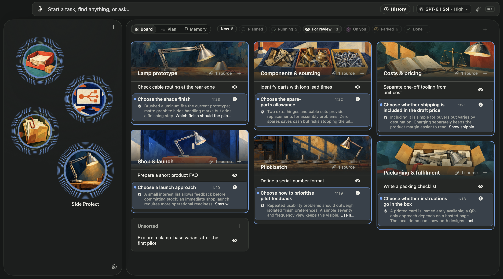

# Facienda

**Run a dozen projects with AI agents. Forget none of them.**

**[Download for Mac](https://github.com/jostelzer/facienda/releases/latest)** · macOS 26+ · works with Claude Code and Codex · Beta

---

## The agents are fine. You're the bottleneck.

Twelve agents running. Three waiting on an email. Two blocked on a question only you can answer. A result that came back an hour ago you still haven't seen.

Every project taxes your attention: finding it, picking it back up, deciding what's next, keeping its dates, briefing the agent again.

Facienda holds the work so your head doesn't have to, and learns how you work so each hand-off gets shorter. The ceiling moves.

## How

**Find work by where it is.** Every project gets a picture and a place on the board. Nothing rearranges itself. You find your taxes the way you find your keys.

**Come back in seconds.** Each task carries a one-glance recap. Rings show what's running and what came back. No re-reading twelve chats.

**Your next step is already written.** Facienda recognises the situation (checks passed, a quote arrived, a choice is needed) and offers the move you made last time, in your own words. Whole workflows start to run one button at a time.

**Watch the world without looking.** Park a task on a reply, a quote, a build, a page changing. An agent checks on its own cadence, for a day or three months, and brings the task back the moment it's ready. No webhooks, no reminders.

**It learns how you work.** Where you file things, what you call them, what you always ask for. Memory you can read, edit and correct, handed to every new task.

**Agents are guests.** Each one acts only on its own task. None can approve, start or finish anything. They ask; you decide. Everything is undoable.

## Not only for code

A paper, a house move, a trip, your taxes. Anything with many threads, long waits and loose ends.

## Local, yours

One SQLite library in your home folder. Inference goes to the provider you chose; nothing else leaves the Mac. [Security model](SECURITY.md).

---

[Build it yourself](CONTRIBUTING.md#build) · [Contribute](CONTRIBUTING.md) · [Security](SECURITY.md) · [Apache 2.0](LICENSE)
